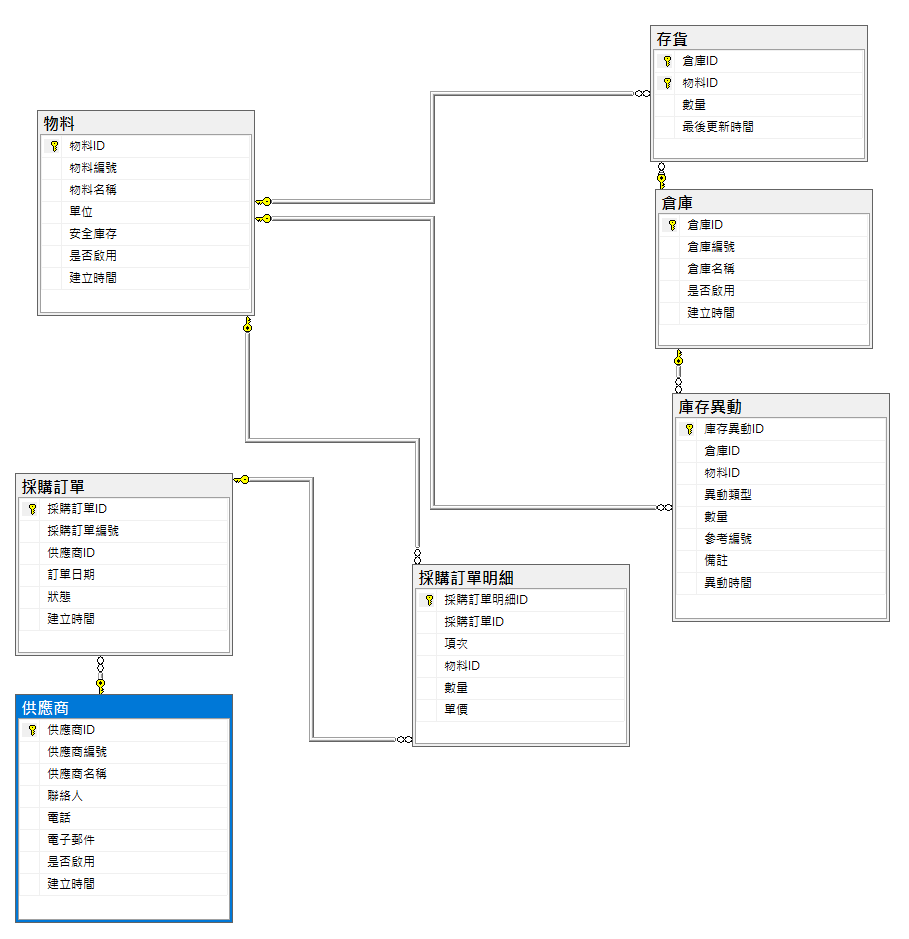
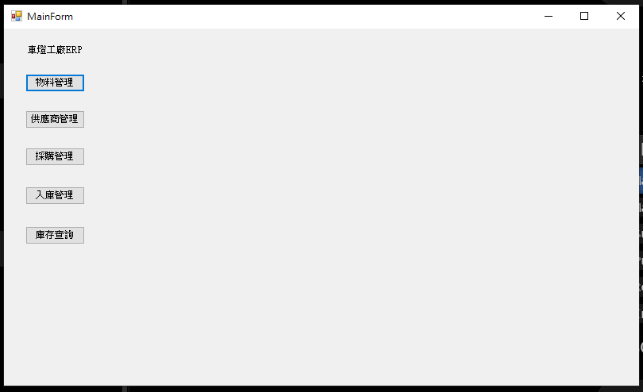
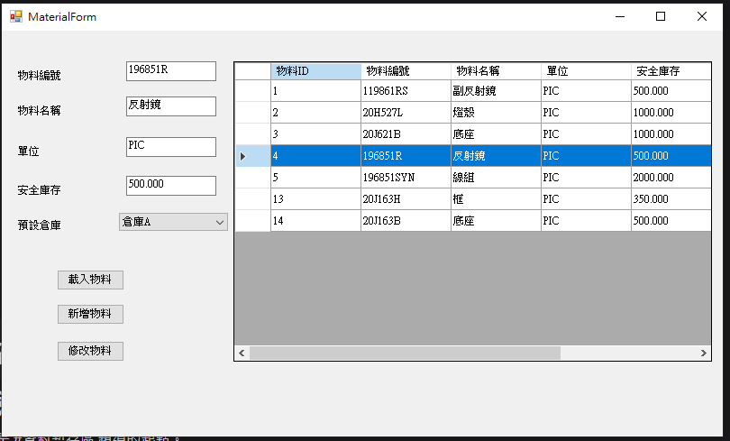
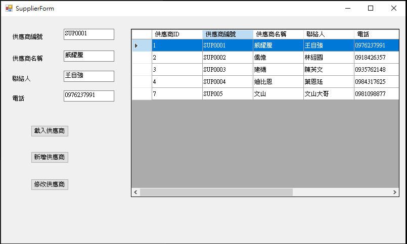
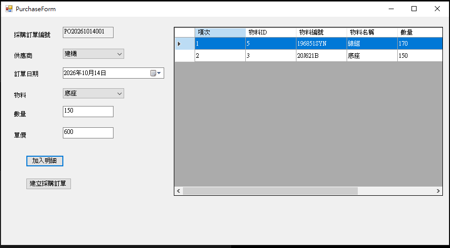
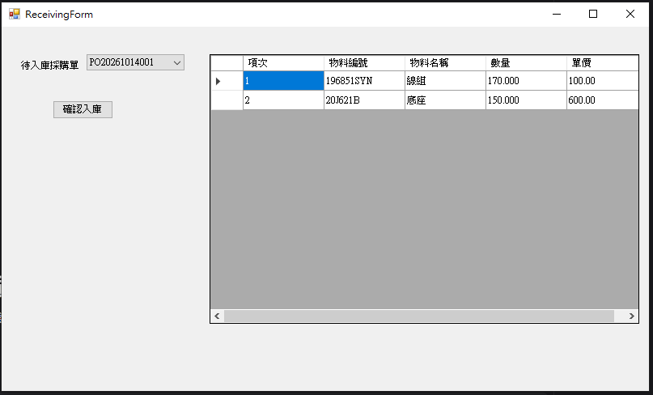
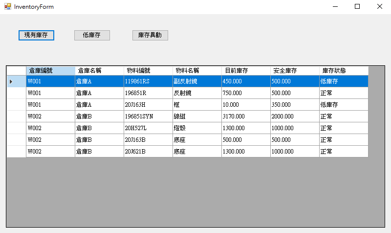
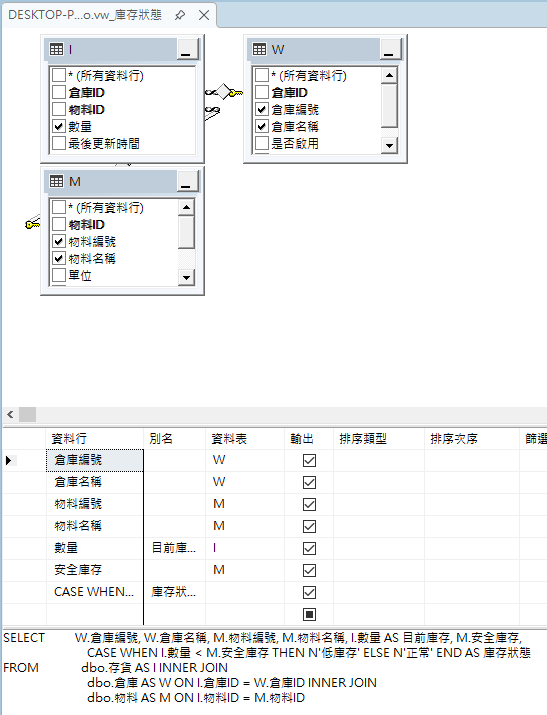

# CarLightFactoryERP

以 C# WinForms 與 SQL Server 開發的小型製造業採購與庫存 ERP 專案。

本專案以車燈工廠的採購與庫存流程作為模擬情境，
實作物料主檔、供應商主檔、採購訂單、採購入庫、
庫存查詢、低庫存以及庫存異動追蹤等功能。
專案重點除了 C# 與 SQL Server 的實作，
亦著重於製造業 ERP 的資料表關聯、單據 Header / Detail、
交易一致性及庫存異動可追溯性。

## 核心業務流程

### 物料建立

新增物料
→ 指定預設倉庫
→ 建立物料主檔
→ 取得新物料 ID
→ 建立初始存貨（數量 0）

### 採購流程

建立採購訂單
→ 建立採購單 Header
→ 建立多筆 Detail
→ Transaction Commit

### 採購入庫

選擇待入庫採購單
→ 執行 Stored Procedure
→ 更新存貨數量
→ 建立庫存異動
→ 將採購訂單狀態更新為「已入庫」

### 庫存查詢

存貨
→ vw_庫存狀態
→ 現有庫存 / 安全庫存 / 低庫存

庫存異動
→ 依異動時間、物料、參考編號追蹤歷史紀錄

## 系統架構

MainForm
├── MaterialForm
│   └── 物料與初始存貨管理
├── SupplierForm
│   └── 供應商管理
├── PurchaseForm
│   └── 採購訂單 Header / Detail
├── ReceivingForm
│   └── 採購入庫
└── InventoryForm
    ├── 現有庫存
    ├── 低庫存
    └── 庫存異動

WinForms
    ↓
ADO.NET / Microsoft.Data.SqlClient
    ↓
SQL Server
├── Tables
├── View
└── Stored Procedure

## 使用技術

- C# / .NET WinForms
- SQL Server
- Microsoft.Data.SqlClient
- ADO.NET
- T-SQL
- Stored Procedure
- View
- Transaction
- Primary Key / Foreign Key / Unique Constraint
- DataTable / DataGridView

## 系統功能

### 1.主選單
- 系統以 MainForm 作為各功能模組入口。

### 2. 物料管理
- 查詢物料主檔
- 新增物料
- 修改物料
- 安全庫存設定
- 指定預設倉庫
- 新增物料時同步建立初始存貨（數量 0）

### 3. 供應商管理
- 查詢供應商
- 新增供應商
- 修改供應商
- 基本輸入驗證

### 4. 採購管理
- 自動產生採購訂單編號
- 選擇供應商
- 建立採購單 Header
- 加入多筆採購明細 Detail
- 計算數量、單價與小計
- 使用 Transaction 確保 Header / Detail 一致性

### 5. 採購入庫
- 查詢待入庫採購單
- 顯示採購明細
- 呼叫 Stored Procedure 執行入庫
- 更新存貨數量
- 建立庫存異動紀錄
- 更新採購訂單狀態

### 6. 庫存查詢
- 現有庫存
- 安全庫存
- 低庫存查詢
- 庫存異動歷程
- 依參考編號追蹤異動來源

## 開發環境

- Windows
- Visual Studio Community
- .NET / WinForms
- SQL Server
- SQL Server Management Studio (SSMS)

## 執行方式

1. 在 SQL Server 建立專案資料庫。
2. 建立所需資料表、Primary Key、Foreign Key、Constraint。
3. 建立 `vw_庫存狀態` View。 
4. 建立 `usp_採購入庫` Stored Procedure。 [查看 usp_採購入庫 SQL 原始碼](sql/usp_採購入庫.sql)
5. 確認程式中的 SQL Server Connection String。
6. 使用 Visual Studio 開啟專案並執行。
7. 從 MainForm 進入各 ERP 功能模組。

## 資料庫設計

本專案包含 7 張主要資料表：

| 資料表 | 用途 |
|---|---|
| 物料 | 物料主檔 |
| 供應商 | 供應商主檔 |
| 倉庫 | 倉庫主檔 |
| 存貨 | 記錄物料於各倉庫的目前數量 |
| 採購訂單 | 採購單 Header |
| 採購訂單明細 | 採購單 Detail |
| 庫存異動 | 記錄庫存歷程與來源 |

## 開發過程中的問題與改善

開發測試過程中曾發現：

新增物料後只有建立「物料主檔」，
若該物料尚未在「存貨」資料表建立紀錄，
採購入庫時即使採購單狀態成功更新，
仍可能無法正確增加該物料的庫存。

因此後續將新增物料流程調整為：

1. 使用 Transaction 建立物料主檔
2. 使用 SCOPE_IDENTITY() 取得新物料 ID
3. 依使用者選擇的預設倉庫建立初始存貨
4. 初始庫存設定為 0
5. 任一操作失敗則 Rollback

## 專案學習成果

透過本專案實際練習：

- 將 ERP 業務需求轉換為關聯式資料表
- 使用 PK / FK / Unique Constraint 維持資料完整性
- 使用 JOIN 與 View 建立 ERP 查詢報表
- 使用 C# ADO.NET 存取 SQL Server
- 使用 DataTable / DataGridView 處理 WinForms 資料
- 理解 Header / Detail 單據設計
- 使用 Transaction 保護跨資料表操作
- 使用 Stored Procedure 處理採購入庫
- 建立庫存異動紀錄以提供資料追溯能力
- 從實際測試中發現並修正資料一致性問題